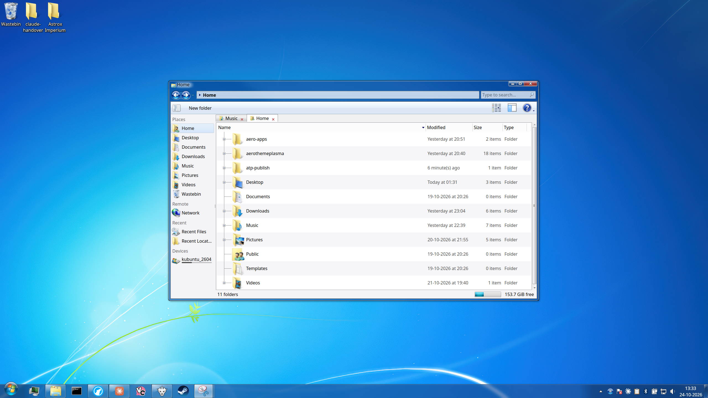
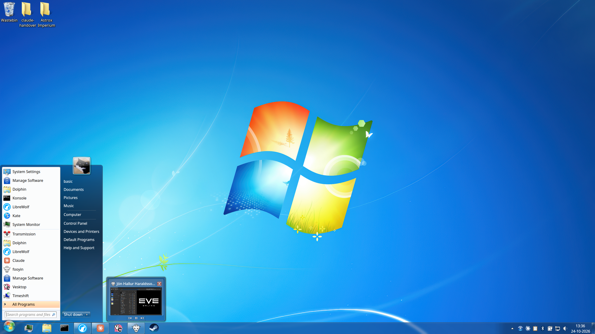
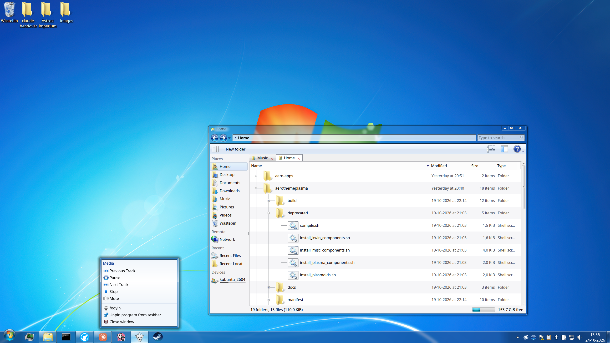
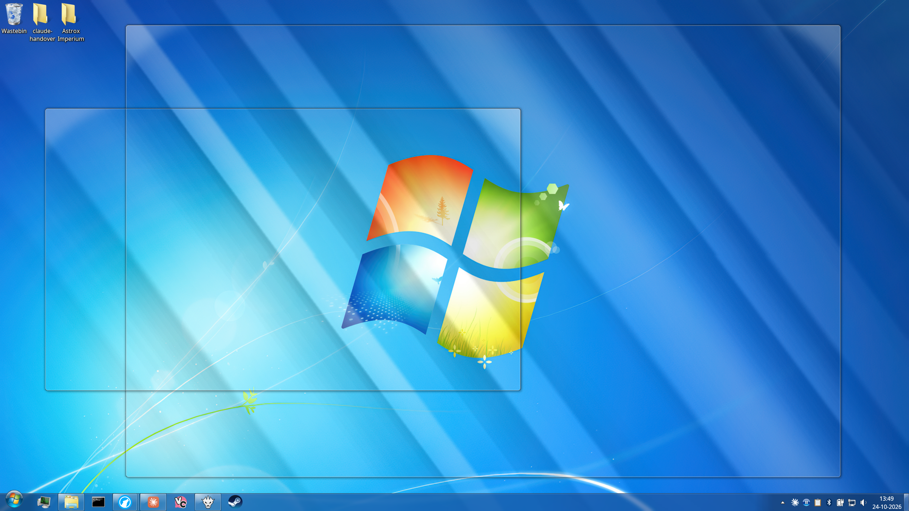
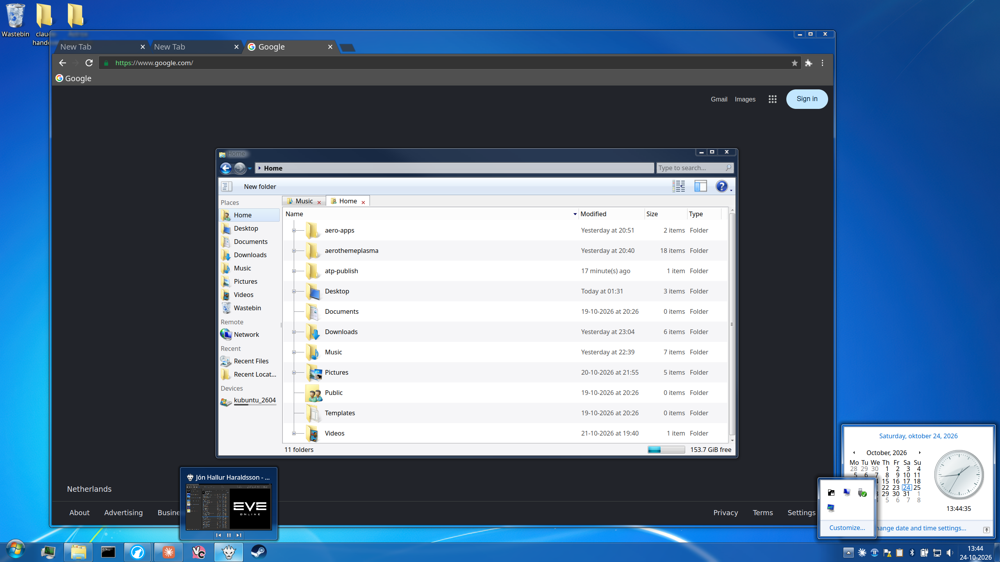
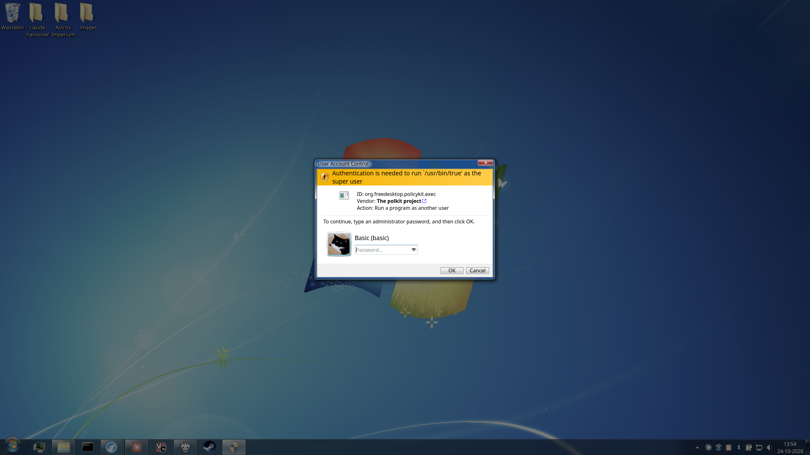
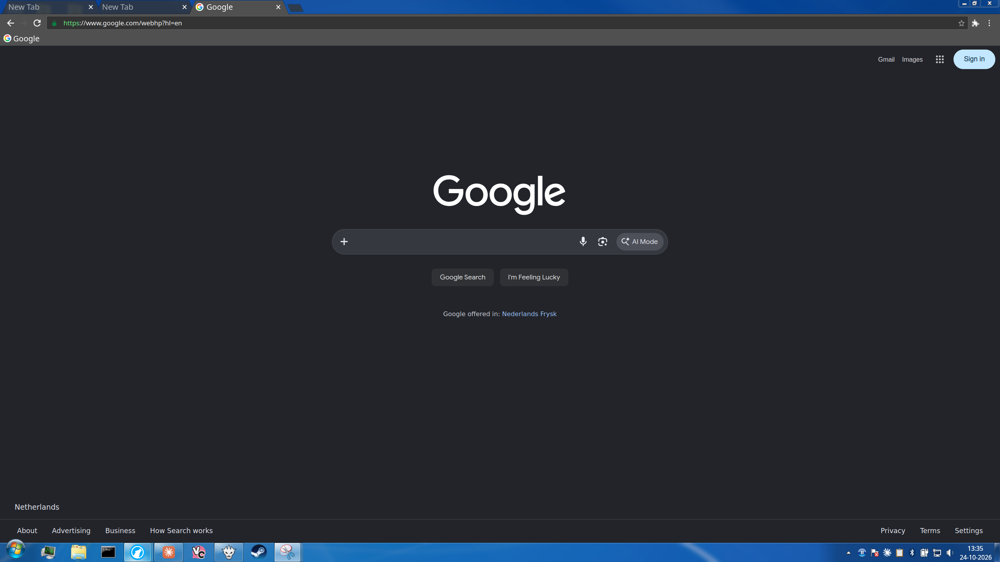

# AeroThemePlasma for Kubuntu 26.04 LTS (personal fork)

A frozen, personal fork of [AeroThemePlasma](https://gitgud.io/wackyideas/aerothemeplasma) by
WackyIdeas and contributors (the Windows 7 look for KDE Plasma), set up and fixed for **one
specific system**:

- **Kubuntu 26.04 LTS** with **Plasma 6.6.6**, KDE Frameworks 6.24, Qt 6.10
- **Wayland** only (installed with `--skip-x11`)
- **Multiple screens**
- **A bigger system font** (11–12 pt) at 100% display scaling, so everything is bigger but stays
  sharp (instead of Wayland's blurry fractional scaling)

It also includes **Aero Dolphin** (the file manager in the Windows 7 Explorer look) and the setup
for **LibreWolf** in the Windows 7 / old Chrome look.

> [!WARNING]
> **Please read before using this.**
> - **No support.** I share this as is. Issues and questions will probably not be answered.
> - **Not actively maintained.** It is frozen at versions that work on the system above. It will
>   not follow updates of the original project, and it will not work on other Plasma versions.
> - **I am not an experienced programmer.** All changes in this fork were made with an AI
>   assistant (Claude, by Anthropic), tested on my own laptop. I can't vouch for them beyond that.
> - For anything else, use the original project:
>   https://gitgud.io/wackyideas/aerothemeplasma

Installation: see **[INSTALL.md](INSTALL.md)**.
The original project's README and install guide are kept as
[README.upstream.md](README.upstream.md) and [INSTALL.upstream.md](INSTALL.upstream.md).

## What's different from the original

All parts of the theme are **included in this repository** (in `repos/`), frozen at versions that
work together on Plasma 6.6.6, so the install script downloads nothing.

Everything below is **fixed** in this repository.

**Making it work on Kubuntu 26.04 LTS**
- The theme's Plasma/6.6 versions (the newest code targets Plasma 6.8); aeroshell-sddm-kcm pinned
  to its last 6.6.5 version.
- libplasma: the theme's version merged with KDE's official 6.6.6, so Ubuntu's library versioning
  can't switch it off. A login check warns when an update replaces it (`tools/`).
- Two version checks lowered to what Ubuntu 26.04 ships (PlasmaActivities 6.6.4,
  wayland-protocols 1.45).
- Everything is built as **Release** (optimised) instead of Debug.

**Multiple screens**
- Tray and taskbar popups opening on the wrong screen (libplasma used screen-relative coordinates).
- The floating start orb sometimes stuck at the top of a screen (KWin applies a new position only
  with the next frame; the orb now redraws once).
- The volume mixer opening on another screen (its position mixed global and screen-relative
  coordinates).

**Bigger font, still sharp**
- Taskbar buttons and icons grow with the taskbar height using the icon theme's real image sizes
  (40 px program icons, 24 px tray icons at a 50 px taskbar); the tray's hidden-icons popup and
  arrow grow along.
- Start menu: "All Programs", "Back", "Shut down", the search field and the profile picture follow
  the system font; the orb sticks out of a shorter taskbar instead of being cut off.
- Taskbar right-click menu, window previews and the clock's calendar pop-up grow with the font.
- The UAC (password) window, its password field and picture grow with the font.

**Other fixes**
- Show desktop button: clicking minimises all windows, hovering shows Aero Peek with glass window
  frames (made to work and run smoothly on Wayland).
- Taskbar previews also show minimised windows (on Wayland KWin can stream them).

**Aero Dolphin** (`apps/aero-dolphin/`, from [Albert Tomanek's fork](https://gitgud.io/atmk/dolphin-aero)
and [libAeroQt](https://gitgud.io/atmk/libaero-qt))
- Back/forward buttons at 125%; address bar and search field as tall as the font needs.
- Tab close buttons grow with the font and line up with the tab text.
- Free-space bars coloured again and the folder tree's expand arrows visible again (the fork's
  application-wide stylesheet hid them; now applied to the window header only).

**LibreWolf** (`extras/librewolf/`): how to combine Geckium and Aero UserChrome with LibreWolf
without losing its privacy settings, plus 100% caption buttons at 125%, a full tab strip that
stays clear of the caption buttons when maximised, and a dark address bar.

## Licenses

Each part keeps its original license; see the license files in each folder.
- AeroThemePlasma, aeroshell-kwin-components, aeroshell-workspace, SMOD, aeroshell-sddm-kcm,
  libAeroQt, the icons and the sounds: **AGPL-3.0** (the icons and sounds with the note that the
  Windows assets belong to Microsoft)
- libplasma: **LGPL** (KDE)
- uac-polkit-agent, Dolphin: **GPL-2.0-or-later**

As the original project notes, Microsoft® Windows™ is a registered trademark of Microsoft
Corporation; the artwork belongs to Microsoft.

## Credits

All credit for AeroThemePlasma goes to [WackyIdeas](https://gitgud.io/wackyideas) and everyone
listed in [README.upstream.md](README.upstream.md); for Aero Dolphin and libAeroQt to
[Albert Tomanek](https://gitgud.io/atmk); for Dolphin and libplasma to KDE.

## Screenshots

Kubuntu 26.04 LTS, Wayland, 2560×1440 at 100% scaling with Segoe UI 12 and a 50 px taskbar.

### Desktop and Aero Dolphin

### Start menu and taskbar preview

### Taskbar right-click menu and Dolphin's folder tree

### Aero Peek (hovering the show desktop button)

### LibreWolf, clock calendar and hidden tray icons

### User Account Control (password window)

### LibreWolf maximised (Geckium + Aero UserChrome, dark mode)

