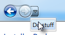
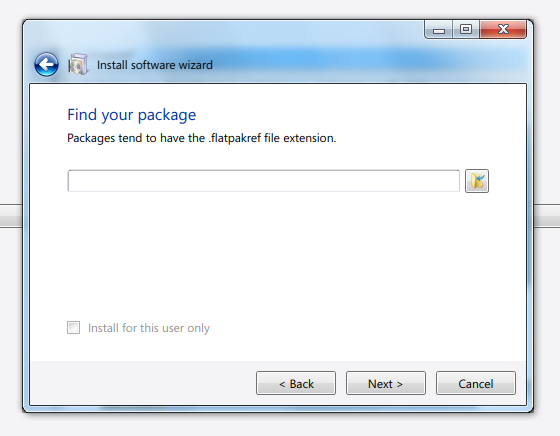
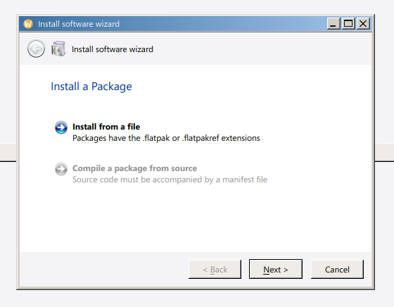
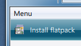
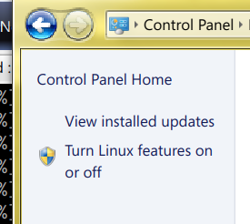

This aims to be a library of reusable Aero-style widget components.
Both QtWidgets and QML components will be shipped in this library.

## Installing

```
mkdir build; cd build
cmake .. -D CMAKE_INSTALL_PREFIX=/usr
make
sudo make install
```

## Widget gallery

Aero::NavButtons



Aero::Wizard::convert(QWizard *)
Aero::makeInsetWindow

 

Aero::registerStylesheet
QToolBar::setProperty("_Aero_styleclass", "black")
QToolBar::setProperty("_Aero_styleclass", "blue")
QToolBar::setProperty("_Aero_styleclass", "azure")



Aero::makeInsetWindow


~~Aero::NotifyStrip~~ Use KNotifyWidget


Aero::InfoStrip


Aero::UserIcon


Aero::Browser


```cpp
auto *b = new Aero::Browser();

QAction *myPgAction = b->addPage("/my/page", []{ return new QLabel("My Page"); });
myPgAction->setText("My Page");
myPgAction->setIcon(...);

myPgAction->trigger();  // Displays the associated page
```

Aero::Sidebar



## Utility functions

The library also includes a couple of utility functions in `util/` to make writing apps in QtWidgets more ergonomic.

### Property binding

If you've ever programmed in Gtk, one of the nice things about the toolkit is that you can bind a property on one GObject instance to a property on another — so they'll stay in sync without you having to connect their getters and setters manually. I've managed to [port that functionality](https://gitgud.io/atmk/libaero-qt/-/blob/master/src/AeroQt/util/props.h?ref_type=heads) over to Qt:

```cpp
bind_prop(lineEdit, "text", nextButton, "enabled", &QLineEdit::textChanged, true, [](QVariant text) { return text.toString().length() > 0 });
```

(the last two arguments are 'sync on create', and a value translator)
This replicates the seamless property binding that QML does automatically.

### Deep property bindings

There are also classes for creating deep bindings in `util/deepbind.h` -- `DeepSource` and `DeepTarget`. Unlike the above function that binds the properties of two specific object instances, these bindings let you jump over several objects using a path to access your source or target property. The binding will update every time an object anywhere along the binding chain changes.

```cpp
DeepSource(this)
        .prop("selectedItem", &ItemSelector::selectedItemChanged)
        .prop("text", &MyItem::textChanged)
        .bind(ui->title, "text");
```

### Property creation

There's a macro to create properties in a single line, like you would in [Vala](https://docs.vala.dev/developer-guides/documentation/vala-for-csharp-programmers/21-properties.html):

```cpp
MAKE_PROPERTY(int, fooBar, FooBar);

Makes:
 * int fooBar()
 * void setFooBar(int)
 * Q_SIGNAL void fooBarChanged()
 * registers it as a property using the Qt macro
```

### Event listeners

Another thing I've written is a [helper class](https://gitgud.io/atmk/libaero-qt/-/blob/master/src/AeroQt/util/objecteventlistener.h?ref_type=heads) that lets you connect to QEvents as if they were signals – like you can do on Gtk:

```cpp
onEvent(this, QEvent::Resize, [](QEvent *e) {
    // do stuff
});
```

Unfortunately Qt provides no guarantee of what order the listeners will run in.

### Scope functions

Kotlin has a nice set of functions called [scope functions](https://kotlinlang.org/docs/scope-functions.html). They let you write neater code by ridding you of the need to create temporary variables. I've managed to port the `.let` and `.also` functions to C++ and tried to make the syntax as similar as possible.

An example of using a scope function to simplify code:

```cpp
QFont f = but->font();
f.setBold(true);
f.setPointSize(8);
but->setFont(f);
```

After:

```cpp
but->setFont(but->font() + also {
    it.setBold(true);
    it.setPointSize(8);
});
```

## Other files

* `AeroQt/util/image9.h` -- Android-like 9-patch bitmap scailing
* `AeroQt/branding.h` -- Retrieving user customization parameters for the Aero theme

---
This code uses [elastic tabs](https://nick-gravgaard.com/elastic-tabstops/).
