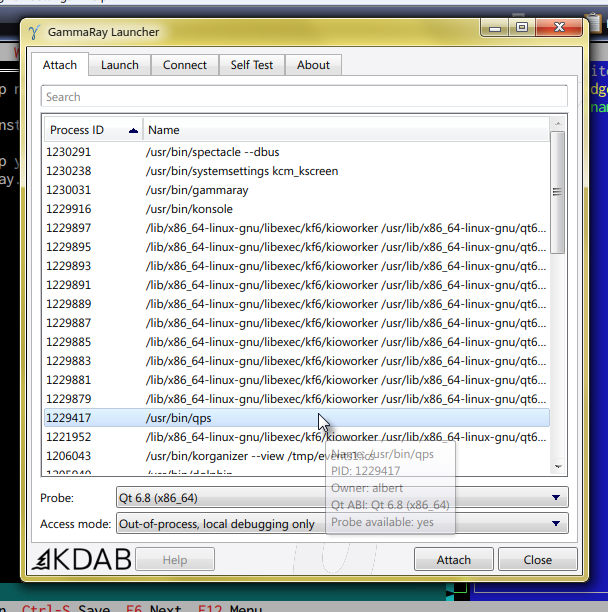
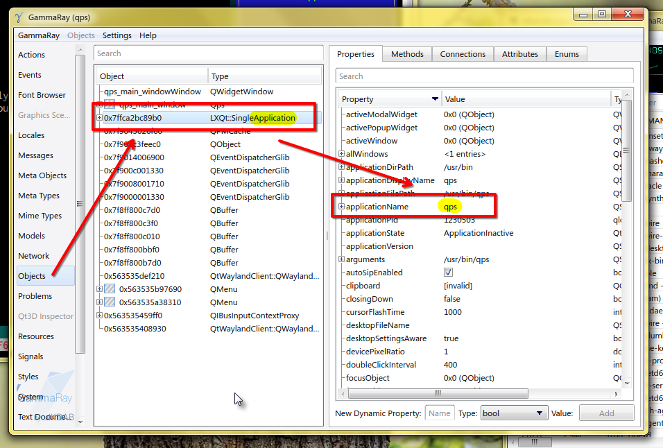

# How to find app name for toolbar rules?

You'll need to install an app called GammaRay. It's like inspect element in browsers, but for Qt apps.

1. Launch the app you want to make a rule for.
2. Launch GammaRay. Select the target app from the list of running apps, and double click it.

3. Go into the `Objects` tab. Search the list for an object where `Type` is something containing 'Application' (usually sth like `QApplication`), and select it.
4. On the right you will see the object's properties. Find the property `applicationName` The value of this is what you need to use for your rule in Borealis.

5. Optional: If you want to configure specific toolbars within the app, go into the `Widgets` view in GammaRay and search through the tree of widgets until you find the toolbar (it'll have the type `QToolBar`). The `objectName` property on that toolbar will be what you need to write into the rule. (Some toolbars might not have object names.)
